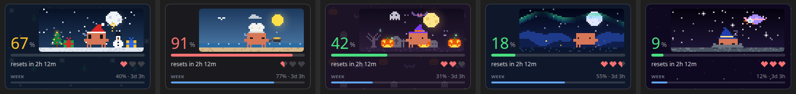

# Clawd Usage for VS Code

Your Claude plan usage in the VS Code sidebar: the 5-hour window and the week, with Clawd the crab walking around in a seasonal scene. He sleeps when no Claude Code session is running, hurries about while one is working, and hops with a question mark when one is waiting for you.

Unofficial fan project, not made by or affiliated with Anthropic.

## Built on

This extension is built from three MIT-licensed projects, and the ideas and artwork are theirs.

- [Enhed/clawd-usage-winwidget](https://github.com/Enhed/clawd-usage-winwidget) is the original Windows widget, where the design and Clawd's animations come from.
- [Ivan1Rev/clawd-usage-linux](https://github.com/Ivan1Rev/clawd-usage-linux) is the Python + Qt port whose Clawd and usage reading are ported here. Its themed fork is [LaineyLouiseWard/clawd-usage-linux](https://github.com/LaineyLouiseWard/clawd-usage-linux).
- [YoussefAbdelkawy/Pinch](https://github.com/YoussefAbdelkawy/Pinch) is the Android home-screen widget whose themes, scenes, outfits and outfit routines are ported here.

## What it shows

- The 5-hour window as a big number and a bar, with the time until it resets. The number turns yellow at 60% and red at 85%.
- The weekly limit with its reset time.
- Hearts for Clawd's health, which drop as the 5-hour window fills.
- The same numbers in the status bar. Click them to open the view.

## Install

You need a Claude Pro or Max plan and [Claude Code](https://docs.claude.com/en/docs/claude-code) signed in, either the CLI or the Claude Code VS Code extension.

1. Download `clawd-usage-<version>.vsix` from the [releases page](https://github.com/LaineyLouiseWard/clawd-usage-vscode/releases).
2. Run `code --install-extension clawd-usage-<version>.vsix`, or in VS Code open the Extensions view, click its `…` menu and choose *Install from VSIX…*.
3. Open the Explorer. Clawd Usage is a section at the bottom, which you can drag into the bottom panel or another sidebar.

## Using it

- Click Clawd and he plays one of Claude Code's click animations.
- The paint-can button in the view's title bar picks the theme. *Follow the season* (the default) picks Halloween in October, Christmas in December, and so on.
- The person button picks his outfit: the theme's own, none, or any of 31. The chef flips pancakes, the programmer types, the wizard casts spells and the detective investigates.
- Settings live under *Clawd Usage* in VS Code's settings, including the refresh interval, the yellow and red levels, and the status bar item.

## How it gets the numbers

Every 60 seconds it runs `claude -p /usage`, the same command as typing `/usage` in Claude Code. That command calls no model, so it uses no tokens and does not count against your limits. It uses the `claude` program bundled with the Claude Code extension if you have it, then the one on your PATH, or the path in the `clawdUsage.claudePath` setting. It leaves out any `ANTHROPIC_API_KEY` set in your environment, because the key would replace your plan login and an API key has no plan limits. Running sessions come from the small status files Claude Code keeps in `~/.claude/sessions/`. The extension only reads those files and runs that one command.

## Structure

- `extension.js` runs inside VS Code. It reads the usage and the sessions, and runs the status bar item, the view and the pickers.
- `media/` holds the view. `scenes.js` draws the scenes, `skins.js` the outfits, props and routines, `mascot.js` Clawd and his moods, and `themes.js` the themes and the seasonal choice. `main.js` lays out the card and runs the animation.
- `media/skins/` and `media/patterns/` are Pinch's outfit files and background tiles.

It is plain JavaScript and runs as written. To package it, run `npx @vscode/vsce package`.

## Licence

MIT. See [LICENSE](LICENSE). The scenes, outfits, patterns and their drawing code are Pinch's, under [LICENSE-pinch](LICENSE-pinch).
